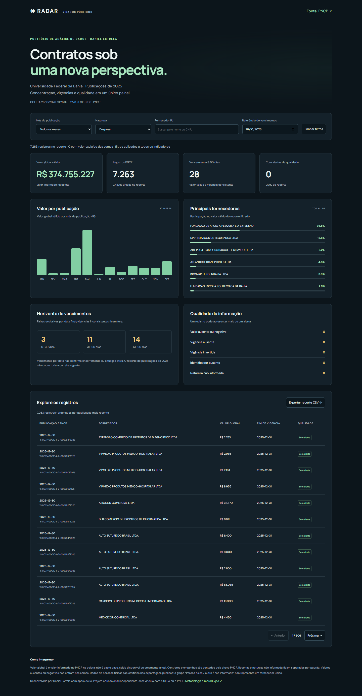
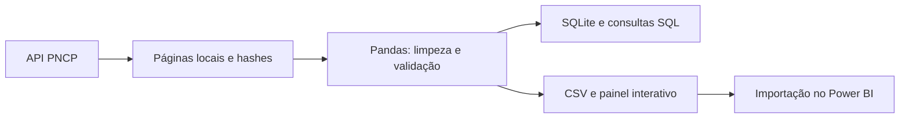

# Radar de Contratos Públicos

**Como acompanhar concentração de fornecedores, vencimentos e qualidade de dados de um órgão público?**

Projeto de portfólio de Daniel Estrela. Usa dados reais do PNCP da Universidade Federal da Bahia, com publicações de janeiro a dezembro de 2025. Pipeline em Python/Pandas, análises em SQLite, painel interativo e arquivos para importar no Power BI.

[**Abrir painel online**](https://danielestrela-dev.github.io/radar-contratos-publicos/) · [Descobertas e decisões](ANALISE.md) · [SQL](sql/analysis.sql) · [Indicadores e limitações](METRICAS.md) · [Power BI](powerbi/README.md)



## Ver o painel

Abra `docs/index.html` no navegador. Os dados acompanham o projeto; não exige instalação para explorar. Há filtros por mês, natureza, fornecedor e data de referência, indicadores, gráficos e exportação do recorte.

O painel é publicado pelo GitHub Pages a partir da pasta `/docs` da branch `main`.

## Executar o pipeline

Python 3.10 ou superior e conexão com a internet:

```bash
python -m pip install -r requirements.txt
python scripts/build.py
python -m unittest discover -s tests -v
```

A execução consulta todas as páginas, verifica contagens e recorte, escolhe a versão mais recente de cada chave PNCP, normaliza os registros, cria `data/contratos.sqlite`, exporta CSVs, atualiza o painel e gera `ANALISE.md`. Falhas são registradas em `pipeline.log` e encerram a execução com erro. Não há atualização agendada ativa.

Para reprocessar as páginas locais sem nova consulta:

```bash
python scripts/build.py --offline
```

Para atualizar a referência das faixas de vencimento:

```bash
python scripts/build.py --referencia 2026-10-26
```

Edite `config.json` para mudar órgão ou período. O painel desta versão tem os 12 meses de 2025; para outros anos, adapte os rótulos em `docs/app.js`. O recorte é por **publicação**, não por assinatura ou pagamento. O endpoint é uma visão atual, não uma fotografia histórica de 2025.

## Caminho dos dados



## Estrutura

- `scripts/build.py`: coleta com paginação, timeout, tentativas e log.
- `sql/analysis.sql`: agregações, CTE, participação e ranking com função de janela.
- `tests/`: testes de valores monetários, deduplicação, qualidade, recorte e dados pessoais.
- `results/`: exportações públicas, sem nomes/CPF de pessoas físicas.
- `data/manifest.json`: parâmetros, horário UTC da coleta, contagens e SHA-256 de cada página bruta.
- `docs/`: painel sem servidor de aplicação, com dados locais.
- `powerbi/`: consulta Power Query, medidas DAX e guia de montagem; não inclui arquivo `.pbix`.
- `.github/workflows/check.yml`: validação automática em pushes e pull requests.

## Decisões que tornam a análise auditável

Valores monetários são convertidos com Decimal e armazenados em centavos inteiros. Receita, despesa e natureza não informada são distintas. Valores ausentes/negativos permanecem visíveis, mas saem das somas. Vigências inválidas saem dos indicadores de vencimento. A deduplicação usa a maior data de atualização global (ou atualização comum, quando ausente); empates preservam a primeira ocorrência recebida. IDs de fornecedores são textos para preservar zeros.

A coleta exige número de páginas estável e reconcilia registros recebidos com o total informado pela API. Isso não garante uma transação consistente no servidor: retificações simultâneas podem alterar páginas. Repita a coleta se houver divergência. O pipeline não publica dados brutos. As exportações podem permanecer da execução anterior em caso de falha; confira o manifesto antes de usar.

## Fonte e autoria

Fonte: [API oficial do PNCP](https://pncp.gov.br/api/consulta/swagger-ui/index.html), endpoint `/v1/contratos`. Registros públicos reutilizados para finalidade educacional; a licença do código não se estende aos dados de terceiros. Sem vínculo com a UFBA ou o PNCP.

Daniel Estrela · [GitHub](https://github.com/danielestrela-dev). Elaborado com apoio de IA na implementação e documentação; revise os resultados e compreenda as decisões antes de apresentá-los profissionalmente.

